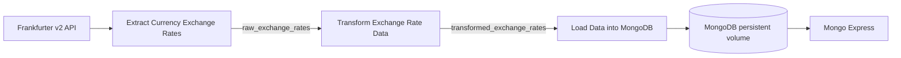

# Task 3 Currency Exchange ETL

An Astro CLI project that retrieves daily Frankfurter exchange rates, validates and transforms them, and upserts them into MongoDB. Mongo Express provides the requested web administration interface.

## Run locally

Requirements: Docker Engine with Compose v2 and [Astro CLI](https://www.astronomer.io/docs/astro/cli/install-cli). Initialized with Astro CLI 1.47.0; pins Astro Runtime 3.3-12 (Airflow 3.3.2).

```bash
python3 scripts/setup_env.py
./scripts/astro.sh dev start --no-proxy
```

The launcher exports `.env` for Compose interpolation and calls your installed `astro` executable, falling back to `.tools/astro` in this workspace. If Docker requires sudo, use `sudo ./scripts/astro.sh dev start --no-proxy`.

Open [Airflow](http://localhost:8080), unpause `currency_exchange_etl`, and trigger a run. Astro uses its local development authentication. Open [Mongo Express](http://localhost:8082) with `MONGO_EXPRESS_USERNAME` and `MONGO_EXPRESS_PASSWORD` from `.env`; select `currency_etl` → `exchange_rates`. Its port is configurable with `MONGO_EXPRESS_PORT` (default 8082).

`scripts/setup_env.py` generates local passwords and preserves nonempty settings. `.env` is excluded from Git and Docker builds. Generate fresh settings on another machine. `.env.example` documents the settings; its placeholder passwords are not intended for use.

## Pipeline and named XComs



Exactly three tasks explicitly push or pull **named Airflow XComs**. Automatic `return_value` XComs are disabled. The load task publishes `mongodb_load_summary` with processed, upserted, matched, and modified counts.

The schedule is **18:00 UTC daily (23:00 Asia/Karachi)**, with catchup disabled and one active run at a time. Every run requests the latest published rates. The API's `date` becomes `rate_date`, so weekends and holidays retain the last available publication date. This DAG does not backfill historical dates; an old logical date still requests the latest rates.

Default request: [EUR to USD, GBP, JPY](https://api.frankfurter.dev/v2/rates?base=EUR&quotes=USD,GBP,JPY). Configure `ETL_BASE_CURRENCY` and `ETL_TARGET_CURRENCIES` in `.env` and restart Astro after changes.

Each transformed document contains the six required fields (MongoDB additionally adds `_id`):

```json
{
  "base_currency": "EUR",
  "target_currency": "USD",
  "exchange_rate": 1.15,
  "rate_date": "2026-11-04",
  "source": "Frankfurter API",
  "retrieved_at": "2026-11-05T07:15:00+00:00"
}
```

This is a schema example. Actual rates and fetch timestamps come from each run. `retrieved_at` is UTC. Transform rejects missing or duplicate currencies, mismatched bases, invalid dates, future publication dates, nonpositive rates, and nonfinite numbers before any database write.

## Docker metadata, networking, and storage

Astro creates the Airflow scheduler, API server, DAG processor, triggerer, and PostgreSQL metadata database. `docker-compose.override.yml` adds MongoDB and Mongo Express to Astro's `airflow` bridge. Airflow connects to `mongodb:27017` using service DNS. PostgreSQL stores Airflow metadata; MongoDB is the primary ETL data store.

MongoDB mounts named `mongodb_data` and `mongodb_config` volumes at `/data/db` and `/data/configdb`. Astro persists its metadata and logs. Normal stops and restarts preserve these volumes. Avoid `astro dev kill` and `docker compose down -v` when retaining data.

All three custom images declare OCI title, description, author, and version labels. MongoDB and Mongo Express have authentication, health checks, and localhost-only published ports. The unique `(base_currency, target_currency, rate_date)` index and `UpdateOne(..., upsert=True)` prevent duplicate rows when retrying. A rerun refreshes `retrieved_at`.

## Validate

```bash
./scripts/astro.sh dev pytest
python3 scripts/verify_airflow.py
```

Use `sudo` for the first command if Docker requires it. Tests cover the data contract, validation, extraction errors, upsert strategy, and the real Airflow DAG parser. The verification script triggers two real DAG runs, checks all three tasks and named XComs, and saves `reports/evidence/airflow_runs.json`.

Inspect real records without exposing credentials:

```bash
docker ps --format '{{.ID}} {{.Names}}'
docker exec -i <scheduler-container-id> python - < scripts/check_storage.py
```

Restart the MongoDB container, then rerun the storage check to verify persistence. Stop the stack with `./scripts/astro.sh dev stop`.

## Submission

The [submission report](reports/Task_3_ETL_Report.docx) contains code and output screenshots. Actual execution evidence is in `reports/evidence/`. Repository: [Hanzala-Shadow/mlops-task-3](https://github.com/Hanzala-Shadow/mlops-task-3). This repository is private; grant your assessor access before submission.

Sources: [Frankfurter documentation](https://frankfurter.dev/), [Astro project development](https://www.astronomer.io/docs/astro/cli/develop-project), [Astro Runtime releases](https://www.astronomer.io/docs/runtime/runtime-release-notes).
